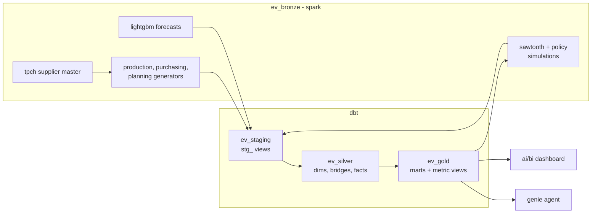

# ev-supply-chain-analytics

[](https://github.com/Troyance/ev-supply-chain-analytics/actions/workflows/ci.yml)

Side project for getting hands-on with Databricks, dbt and supply chain planning. It models a made-up EV maker:
three vehicle models built at two plants, about 1,900 parts, about 800 suppliers and a service parts DC - from
purchase orders all the way to forecasts, buy signals and a comparison of ordering policies.

The data is synthetic but calibrated to look like the real thing: about 95k vehicles a year, about $45k of parts
per vehicle, about 93% supplier on-time delivery, 3 week lead times locally and 12 weeks from asia, a chip shortage
in 2021-22 and a second plant that's still ramping up.

## How it fits together



Spark notebooks stand in for the source systems (erp, mes, wms) and the ml / simulation jobs, and land everything
in bronze. dbt owns everything after that. The simulations read gold and write back to bronze, so dbt runs twice.

## Data model

Kimball style - conformed dimensions, one grain per fact, marts on top. Full detail in [docs/data_model.md](docs/data_model.md).

| fact | grain | date | site | vehicle model | part | supplier | forecast | policy |
|---|---|---|---|---|---|---|---|---|
| `fct_vehicle_builds` | week x site x vehicle model | x | x | x | | | | |
| `fct_po_deliveries` | one delivery line | x | x | | x | x | | |
| `fct_part_demand` | week x site x part | x | x | | x | | | |
| `fct_inventory_snapshot` | snapshot date x site x part | x | x | | x | | | |
| `fct_forecast` | run x series x origin week x target week | x | x | x | x | | x | |
| `fct_policy_simulation` | policy x site x part x day | x | x | | x | | | x |

A few things that took some thought:

- **supplier tier is scd type 2.** a 2022 delivery is judged by the tier the supplier had in 2022, and each month's
  tier only uses the 12 months before it
- **parts and suppliers are many to many** (some parts are dual-sourced), and so are vehicle models and parts (the
  bom), so both are bridge tables
- **forecasts are append-only.** every run keeps its own id, so old forecasts can be scored against what actually
  happened. the grain test caught that I'd left origin week out of the grain the first time
- **plant demand is never forecast directly.** builds are forecast, then exploded through the bom. only service
  parts get their own forecast
- **the generators know things analytics doesn't** - each supplier's true late rate, which ones are secretly
  slipping. staging drops those columns, so everything downstream has to find the bad suppliers from history alone

## Testing

- every dimension, bridge, fact and mart has an enforced contract (column types), named primary and foreign keys in
  unity catalog, a grain test and relationship tests. about 160 tests run on every build
- a unit test on the supplier tier logic
- ci builds everything into separate `ci_` schemas on every pull request

## Semantic layer

Metric views in `ev_gold` define every kpi once (on-time rate, wape, stockout rate, days of cover, spend at risk...).
Ratios are always sum / sum, never averaged. The dashboard and the genie agent both read these, so they always agree.

## What it shows

- **suppliers** - asia is about 4x slower than north america, electronics fell apart during the chip shortage, and
  the declining flag picks out all 11 secretly slipping suppliers with no false alarms
- **sourcing risk** - battery materials carry most of the spend that depends on unreliable suppliers
- **forecast** - lightgbm (m5 style: one global model, direct multi-horizon, tweedie for lumpy service parts) gets
  build forecasts to 7.5% wape vs 18.3% for the naive baseline
- **ordering policies** - six policies replayed on a year of real demand. at a steady plant, carrying more safety
  stock pays for itself (high service costs $125M a year against $305M for the current rules). at the ramping
  plant every policy gets the same launch pre-build, but buffers sized from trailing usage fall further behind as
  volume climbs - shortages grow from 1% of demand to 34% by month nine. only planning off the build schedule (mrp)
  keeps up, at 99.8% fill

## Running it

Everything runs as one Databricks job, defined in `databricks.yml`:

```bash
databricks bundle deploy
databricks bundle run ev_supply_chain
```

For local dbt work: `./dbt.sh build` (reads your token from `~/.databrickscfg`). The dashboard is generated by
`dashboards/build_dashboard.py` and the genie agent by `genie/build_genie.py`.

## Stack

Databricks (serverless, unity catalog, delta, ai/bi dashboards, genie, mlflow) · dbt core with dbt-databricks ·
pyspark · lightgbm · github actions
